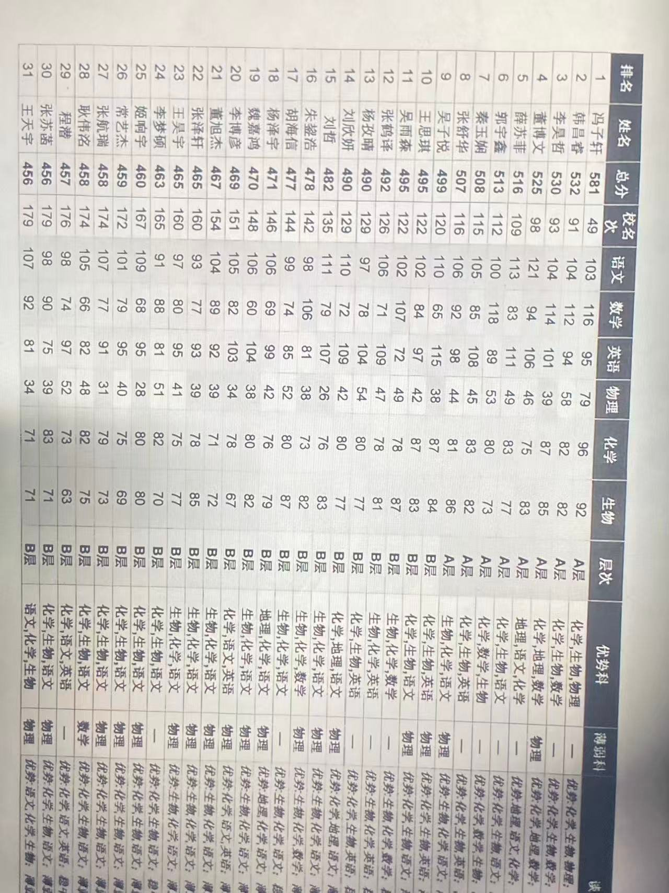
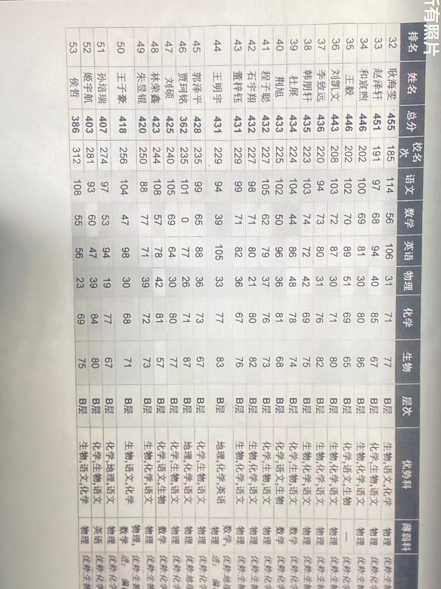

11 月 3—4 日的阶段性测验成绩出来了。这次我不只记录自己的分数，也把班级整体情况一起看了一遍。原因很简单：班名第 1 只能说明个人位置，班级的层次结构、分数段分布和中位段，才更能说明这次考试的整体面貌。

## 一、我的成绩

| 项目 | 分数/位置 |
| --- | --- |
| 总分 | 581 |
| 班级排名 | 1 |
| 校名次 | 49 |
| 层次 | A 层 |
| 语文 | 103 |
| 数学 | 116 |
| 英语 | 95 |
| 物理 | 79 |
| 化学 | 96 |
| 生物 | 92 |
| 优势科 | 化学、生物、物理 |
| 薄弱科 | 无 |

六科之和为 103 + 116 + 95 + 79 + 96 + 92 = 581，与总分一致。

这次我在 A 层第 1，校名次 49。分析表把化学、生物、物理列为优势科，薄弱科为“无”。不过从分数结构看，语文 103、英语 95 在六科里相对不突出，物理 79 也还有提升空间。所谓“无薄弱科”，更像是没有明显拖后腿的单科，不代表没有需要补的地方。

## 二、班级整体画像

这次全表 53 人，前 9 名为 A 层，其余 44 人为 B 层。班级整体数据大致如下：

| 指标 | 数据 |
| --- | --- |
| 班级人数 | 53 人 |
| 班级总分均分 | 约 461.5 |
| 班级总分中位数 | 458 |
| 最高分 | 581 |
| 最低分 | 386（另有 1 名同学物理 0 分、总分 362，疑似缺考/未涂卡，单独标注） |
| A 层人数 | 9 人 |
| B 层人数 | 44 人 |
| A 层均分 | 约 523.4 |
| B 层均分 | 约 448.9（含上述异常记录；剔除后约 450.9） |
| A 层校名次范围 | 49—120 |
| B 层校名次范围 | 122—312 |

从分数段看，500 分以上 8 人，A 层第 9 名是 499 分；460 分以上 25 人，459 分以下 28 人。也就是说，班级中位数在 458 分，班级中后段人数略多。A 层门槛 499，B 层最高 495，A/B 分界只差 4 分，临界段非常紧。

班级结构可以概括为：**A 层人数少，B 层是主体；A/B 层在 500 分附近分界，B 层内部跨度较大。** 这次班级第二 532、第三 530，两人只差 2 分；除我之外，A 层内部的竞争比较接近。我的 581 分比班级第二高 49 分，比班级均分高约 119.5 分，比中位数高 123 分。个人在班内是明显的单点高位，但班级整体中位段仍在 458 分左右，不能把个人第 1 等同于班级整体已经很强。

另外，这次数据里有一名同学物理 0 分、总分 362，疑似缺考或未涂卡，使班级最低分和平均分被拉低。班级统计含该记录时均分约 461.5，剔除后约 463.4；文中已单独说明，不把它当作正常分数波动。

## 三、我在班级中的位置

我在 A 层第 1、班级第 1、校名次 49。和班级结构对照，我的优势主要在理科：数学 116、化学 96、生物 92，物理 79 也被列入优势科。但物理 79 放在六科里并不算高，后面需要继续观察。

语文 103、英语 95 是我相对不突出的两科。阶段测验没有把语文、英语列为薄弱科，但从班级整体看，A 层门槛在 499，B 层最高 495，分数咬得很紧；对我来说，真正能继续拉开空间的，可能不是已经靠前的理科，而是语文和英语的稳定积累。

## 四、下阶段计划

1. **保持理科节奏**：数学、化学、生物继续按错题和限时训练推进，不因为班名第 1 就放松。
2. **物理单独复盘**：79 分虽然被列为优势科，但仍有提升空间，重点看失分题型。
3. **语文英语日常化**：每天固定时间做阅读、文言文、词汇和完形，不等到考前集中补。
4. **看班级结构，不只看班名**：A 层只有 9 人，B 层 44 人，班级提升空间主要在中后段；对自己来说，下一步是把“班内第 1”往“校名次更稳”推。

阶段性测验先记录到这里。班名第 1 是结果，但更值得记住的是：A/B 层分界只有 4 分，分数结构比名次更值得复盘。

## 附：成绩表原图

