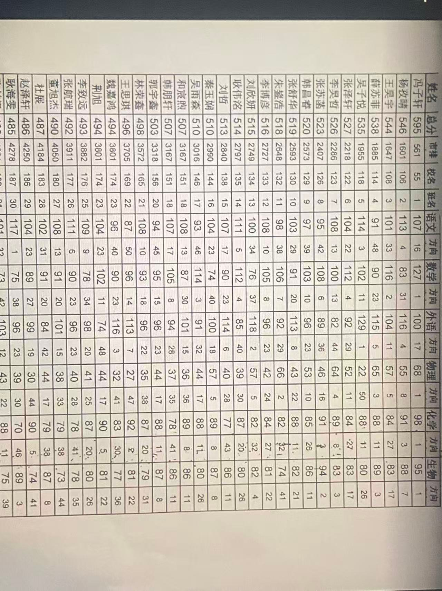
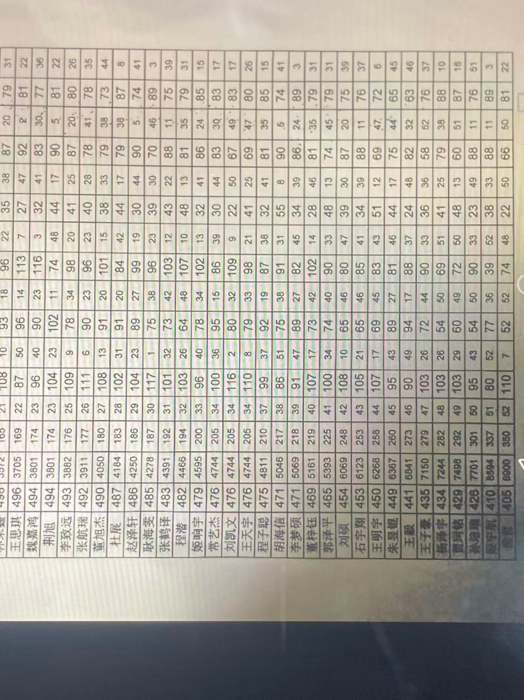

11 月 17 日到 18 日，高三上学期的期中考试结束了。这是进入高三以来的第一次大考，成绩出来后我做了一份简单的记录和分析。

## 成绩单

| 科目 | 分数 | 满分 |
| --- | --- | --- |
| 语文 | 107 | 150 |
| 数学 | 127 | 150 |
| 外语 | 100 | 150 |
| 物理 | 68 | 100 |
| 化学 | 98 | 100 |
| 生物 | 95 | 100 |
| **总分** | **595** | **750** |

- 市名次：561
- 校名次：55
- 班名次：1

比班里第二名（杨孜晴 546 分）高出 49 分，继续保持在班级第一的位置。

## 各科情况

理科依旧是最稳的部分：数学 127、化学 98、生物 95，这三门都是班内第一；物理 68 分看起来不高，但同样是班内第一——这次物理卷子整体偏难。

短板也很清楚：语文 107 分（班内第 16）、外语 100 分（班内第 17）。这两科满分都是 150，加起来丢了 93 分，是总分没能再往上走最直接的原因。

## 一点想法

和 9 月开学定位考的 581 分相比，这次提高了 14 分。

但市名次从 321 变成了 561。分数涨了、位次反而退了，说明两次考试的卷子难度和参与人数并不一样，**分数不能直接横向比较，位次才是更真实的位置**。

接下来的重心要往语文和英语上放一放：理科的优势已经比较稳定，而语文、外语每提高 10 分，对总分和位次的影响会明显得多。

## 成绩表

